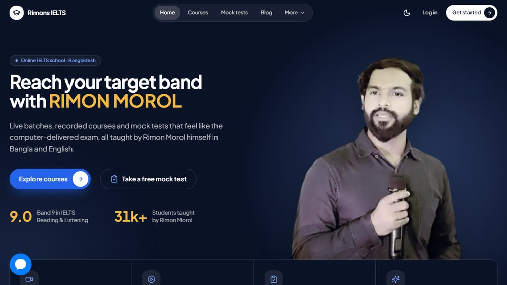
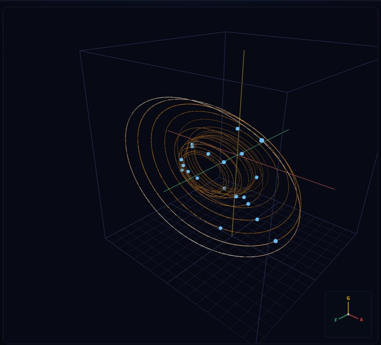

# Hi, I'm Ikramul 👋

**Software Engineer · Applied ML Researcher · Undergraduate Teaching Assistant**

- 💻 **Building:** RimonsIELTS, as the sole engineer across four production apps.
- 🔬 **Researching:** physics-informed ML, scientific computing, and systems security.
- 🎓 **Studying:** B.Sc. in CSE at United International University; graduation expected **early 2027**.
- 🧑‍🏫 **Teaching:** DBMS, DSA-I, ICS, and Software Engineering labs at UIU since **August 2025**.
- 📍 **Dhaka, Bangladesh** · Open to software engineering / applied ML roles and research collaborations.

## Selected work

**[RimonsIELTS · production software](https://ihmorol.me/projects/elearning-platform)** &nbsp; / &nbsp; **[ODE 3D Orbit · interactive mathematics](https://github.com/ihmorol/ode-3d-orbit)**

## 💻 Software & systems

| Project | At a glance |
| :--- | :--- |
| **[RimonsIELTS](https://ihmorol.me/projects/elearning-platform)** | **Sole engineer · Live** Student portal · REST API · Admin dashboard · Python service [Live site ↗](https://rimonsielts.com) |
| **[Advyon](https://github.com/ihmorol/advyon-client)** | **Team lead · Five-person team · Project-show Champion** Legal cases · Documents · Community · AI assistance [Case study ↗](https://ihmorol.me/projects/advyon) |
| **[BriefLi](https://github.com/ihmorol/briefli)** | **Personal product · Live** Shortlinks · AI-suggested slugs · Click analytics · Public/private spaces [Live site ↗](https://s.ihmorol.cv) |
| **[VoiceKey](https://github.com/ihmorol/voicekey)** | **Python tool · Alpha** Voice typing · Linux/Windows · CLI/daemon · Local by default, cloud opt-in |
| **[PrintSlot](https://github.com/ihmorol/PrintSlot)** | **Team contribution** Campus printing · Uploads · Pricing · Order tracking · Pickup booking |
| **[Fall Detection](https://github.com/ihmorol/fall-detection-wearable-device)** | **Embedded ML / IoT** Wearable → on-device model → alert service → caregiver dashboard |

<strong>Project details: scope, stack, and team contributions</strong>

- **RimonsIELTS:** Next.js student portal, Express/TypeScript API, React admin, and Python central service. Mock tests, video courses, content management, and production releases. Commercial work since 2025.
- **Advyon:** Led a five-person team through the software-development lifecycle. React, Express, TypeScript, and MongoDB. The linked repository is the public frontend.
- **BriefLi:** React, TypeScript, Supabase, Clerk, and Vercel. SQL migrations, link ownership, trash/restore, and click tracking.
- **VoiceKey:** Python and faster-whisper, with model profiles, CLI/daemon modes, and platform adapters. Alpha-stage tooling with local transcription by default.
- **PrintSlot:** React Native/Expo, NestJS, and Supabase. Team ParaDox project; the linked repository is a fork of [the team's upstream](https://github.com/AbuBakar223200/PrintSlot).
- **Fall Detection:** Arduino wearable, Edge Impulse/TinyML model, Node.js alerts, and Next.js dashboard. Firmware, model tooling, backend, and dashboard form the system.

<strong>More builds: tools, platforms, and earlier projects</strong>

| Project | Focus |
| :--- | :--- |
| [ODE 3D Orbit](https://github.com/ihmorol/ode-3d-orbit) | 16-system explorer · Three.js · RK4 · [Live demo](https://ode-3d-orbit.vercel.app) |
| [Shera Bot](https://github.com/ihmorol/shera-bot) | Multi-agent platform prototype · approval-gated actions |
| [Carried](https://github.com/ihmorol/carried) | Shareable book-response cards · Next.js |
| [Paradox Prism](https://github.com/ihmorol/paradoxical-prism) | Anonymous reporting · artwork gallery · steganography |
| [Skill Paradox](https://github.com/ihmorol/skill-paradox-frontend) | Skill exchange · booking · real-time chat |
| [IELTS Paradox](https://github.com/ihmorol/ielts-paradox) | JavaFX desktop learning application |
| [Meme Research Console](https://github.com/ihmorol/data-collection-web) | Human-perception research data collection |
| [Shera Clip](https://github.com/ihmorol/shera-clip) | Class-to-clip tooling · phase-one prototype |
| [Email Templates](https://github.com/ihmorol/email-template-generator) | Reusable HTML email templates |
| Task Manager | React Native assignment · frontend-only · local state |
| [This portfolio](https://github.com/ihmorol/portfolio) | Next.js · structured content · Markdown blog |

[All project case studies ↗](https://ihmorol.me/projects)

## 🔬 Research

| Study | Status & focus |
| :--- | :--- |
| **[Lorenz-1960 PINN](https://github.com/ihmorol/lorenz1960-pinn)** | **FYDP-II defended · Submitted to ICEEICT 2027** ODE residual training · Numerical baselines · Archived experiments [Windowed study ↗](https://github.com/ihmorol/lorenz1960-windowed-pinn) |
| **[Physics-residual attack detection](https://github.com/ihmorol/pinn-cps-robo)** | **Research case study · Manuscript draft** ROAD dataset · CAN masquerade attacks · Physics-free comparisons Includes a negative result on PINN attribution. |
| **[DT-NB hybrid study](https://github.com/ihmorol/dt-nb-noise-removal)** | **Manuscript written · Not submitted** Instance filtering · Attribute weighting · Held-out evaluation |
| **UNSW-NB15 class imbalance** | **University term-paper study · Private code** Class weighting / SMOTE · LR / RF / XGBoost · Rare-class analysis |
| **Hybrid nanofluid ANN** | **Scientific ML · Active extensions · Private code** Boundary-layer flow · Physics-generated data · Numerical comparison |

<strong>Methods, thesis context, and earlier experiments</strong>

### Lorenz-1960 thesis

- **Team:** Team Paradox, United International University.
- **Supervisor:** Dr. Muhammad Nomani Kabir.
- **Current method:** physics-informed network trained on the ODE residual, with a hard-constrained initial condition.
- **Evidence:** numerical reference, architecture comparisons, archived paper runs, and a separate windowed long-horizon study.
- **Earlier phase:** ANN architecture search and reference-solver verification. This is historical context, not the current thesis method.
- **Publication status:** submitted to ICEEICT 2027; not presented here as accepted or published.

### Other studies

- **ROAD / CAN:** tests whether physics-residual signals detect masquerade attacks and whether the PINN itself adds value. Results are case-study evidence, not a deployment claim or proof of general PINN superiority.
- **DT-NB:** compares Naive Bayes instance filtering and tree-based attribute weighting, including their combinations, with training-fold refits and held-out evaluation.
- **UNSW-NB15:** an 18-experiment balancing study comparing class weighting, SMOTE, and unbalanced training, with rare-class analysis.
- **Hybrid nanofluid:** nine-layer ANN, Levenberg–Marquardt optimization, and approximately 32,400 physics-generated samples, as described in the portfolio. Current work extends the boundary-layer direction to new equation systems.

[Research overview ↗](https://ihmorol.me/research)

<strong>More research: optimization, forensics, and literature reviews</strong>

| Work | Focus |
| :--- | :--- |
| [PhORM](https://github.com/ihmorol/pinn-shape-optimization) | PINN-in-the-loop robot shape optimization |
| [AI-image forensics](https://github.com/ihmorol/spatial-spectral-forensics) | Pixel/frequency features · JPEG compression · Unseen generators |
| [PINN review](https://github.com/ihmorol/pinn-review) | Literature-review dossier · In progress |
| [Big Data ML Review](https://github.com/ihmorol/big-data-ml-review) | Team course literature review, not an original published research result |

## 🎓 Education, teaching & recognition

**B.Sc. CSE · United International University**  
Scholarships: **6 × 100% · 1 × 50% · 1 × 25%**

**Undergraduate TA:** `DBMS` · `DSA-I` · `ICS` · `Software Engineering`  
Lab sessions · tutorials · office hours · code reviews · assignment feedback

- 🥇 **Champion & team lead:** Advyon, UIU CSE Project Show.
- 🥇 **Champion:** UIU CSE Week Programming Contest, an individual contest result.
- 🥈 **1st Runner-Up:** Advanced OOP / Java Showcase.
- 🏅 **6th Runner-Up:** System Analysis & Design Lab Showcase.

**Competitive programming, 2022–2025:** 500+ problems solved.  
[Codeforces · ekramul11](https://codeforces.com/profile/ekramul11) · LeetCode · HackerRank. No longer active in contests.

## 🛠️ Toolbox

**Languages**  
      

**Web & mobile**  
     

**Backend & data**  
       

**ML & scientific computing**  
  

**Tools & delivery**  
       

## ✍️ Writing

- **Research:** Solving the Lorenz-1960 ODE With a Physics-Informed Neural Network.
- **Software:** Building BriefLi: A Link Shortener Designed for Daily Use.
- **Teaching:** Common Linked-List Bugs: Lessons From Grading DSA-1 Submissions.

[Read the articles ↗](https://ihmorol.me/blog) · [What I'm doing now ↗](https://ihmorol.me/now)

---

**Software engineering · Applied ML roles · Research collaborations**  
[Portfolio](https://ihmorol.me) · [LinkedIn](https://www.linkedin.com/in/ihmorol/) · [ihmorol@gmail.com](mailto:ihmorol@gmail.com)
