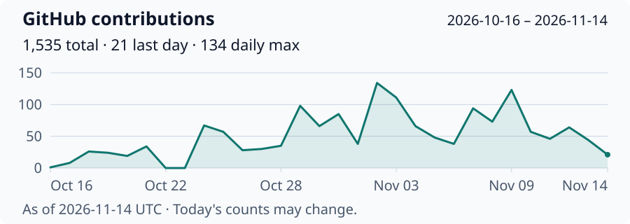

<!-- Header Wave Banner -->

  

<!-- Typing Animation -->

  <picture>
    <source media="(prefers-color-scheme: dark)" srcset="https://readme-typing-svg.demolab.com?font=Fira+Code&weight=600&size=21&duration=3000&pause=800&color=5EEAD4&center=true&vCenter=true&width=620&height=50&lines=Full-Stack+Developer;Applied+ML+Researcher;Sole+Engineer+at+RimonsIELTS;Undergraduate+TA+at+UIU;FYDP-II+Defended" />
    
  </picture>

<!-- Profile Views + Followers + Contributions -->

  
  &nbsp;
  
  &nbsp;
  

---

## About Me

I build **production software** and study **physics-informed machine learning**. Based in **Dhaka, Bangladesh**, I'm finishing my CSE degree while working as a software engineer and undergraduate teaching assistant.

- 💻 **Building** - Sole engineer at **[RimonsIELTS](https://rimonsielts.com)**, owning four production apps: a student portal, REST API, admin dashboard, and Python service.
- 🔬 **Researching** - Physics-informed neural networks, scientific computing, and physics-residual attack detection, with side studies in AI-image forensics and boundary-layer flow.
- 📝 **Thesis** - **FYDP-II defended**. My team's Lorenz-1960 PINN manuscript is **submitted to ICEEICT 2027**. [Code & experiments](https://github.com/ihmorol/lorenz1960-pinn).
- 🧑‍🏫 **Teaching** - **Undergraduate TA @ UIU since Aug 2025**, supporting **DBMS, DSA-I, ICS, and Software Engineering** labs.
- 🎓 **Education** - Final-year **B.Sc. in CSE @ United International University** · **CGPA 3.94/4.00** · Expected graduation **early 2027**.
- 🌟 **Scholarships** - **8 merit scholarships**: **6 at 100%**, **1 at 50%**, and **1 at 25%**.
- 🏆 **Leadership** - Led the **five-person Advyon team** to **Champion at the UIU CSE Project Show**.
- 🧩 **Algorithmic background** - **500+ problems solved during 2022–2025** on Codeforces, LeetCode, and HackerRank. My current focus is software and research.
- 🤝 **Open to** - New-grad **software engineering / applied ML roles** and **research collaborations**.

💻 **[Portfolio](https://ihmorol.me)** &nbsp;·&nbsp; 🔬 **[Research](https://ihmorol.me/research)** &nbsp;·&nbsp; ✍️ **[Writing](https://ihmorol.me/blog)** &nbsp;·&nbsp; 📫 **[Email](mailto:ihmorol@gmail.com)**

---

## Featured projects

| Project | What it does | Stack | Links |
|---|---|---|---|
| **RimonsIELTS** | IELTS courses and mock tests. I'm the sole engineer for the student portal, API, admin, and Python service. | Next.js, Express, TypeScript, Python | [Live](https://rimonsielts.com) · [Details](https://ihmorol.me/projects/elearning-platform) |
| **Advyon** | Case management, documents, and AI help for legal work. I led the five-person team that won the UIU project show. | React, Express, TypeScript, MongoDB | [Client](https://github.com/ihmorol/advyon-client) · [Live](https://advyon.vercel.app) |
| **BriefLi** | My link shortener with AI-suggested slugs, click counts, and public or private link lists. | React, TypeScript, Supabase | [Code](https://github.com/ihmorol/briefli) · [Live](https://s.ihmorol.cv) |
| **ODE 3D Orbit** | A 3D explorer for 16 equation systems. Change equations and constants while they run. | JavaScript, Three.js, RK4 | [Code](https://github.com/ihmorol/ode-3d-orbit) · [Live](https://ode-3d-orbit.vercel.app) |
| **Fall Detection** | A wearable runs a fall-detection model and sends alerts to a caregiver dashboard. | Arduino, TinyML, Node.js, Next.js | [Code](https://github.com/ihmorol/fall-detection-wearable-device) |
| **VoiceKey** | Voice typing for Linux and Windows. Local by default, with an optional cloud fallback. **Alpha.** | Python, faster-whisper | [Code](https://github.com/ihmorol/voicekey) |
| **PrintSlot** | A team-built campus printing app with file uploads, pricing, order tracking, and pickup booking. | React Native, Expo, NestJS, Supabase | [Team repo](https://github.com/AbuBakar223200/PrintSlot) |

More projects on my [portfolio](https://ihmorol.me/projects).

---

## Research

- **[Lorenz-1960 PINN](https://github.com/ihmorol/lorenz1960-pinn)** · **FYDP-II defended; submitted to ICEEICT 2027.** Our team studies how a network can learn an ODE solution from the equations alone. Includes numerical baselines and a [windowed study](https://github.com/ihmorol/lorenz1960-windowed-pinn). Supervisor: Dr. Muhammad Nomani Kabir.
- **[CAN attack detection](https://github.com/ihmorol/pinn-cps-robo)** · **Research case study.** Tests physics-based signals on ROAD vehicle-network attacks. Also reports where PINNs do not improve on models without physics constraints.
- **[DT-NB hybrid study](https://github.com/ihmorol/dt-nb-noise-removal)** · **Manuscript written, not submitted.** Compares filtering training samples with selecting and weighting features in decision-tree/Naive Bayes models.
- **UNSW-NB15 class imbalance** · **Course paper; code private.** An 18-experiment comparison of class weighting, SMOTE, and no balancing for intrusion detection.
- **Hybrid nanofluid flow** · **Ongoing; code private.** Uses neural networks to model fluid flow and heat transfer, checked against numerical solutions.

More on my [research page](https://ihmorol.me/research).

---

## Achievements

- 🥇 **Champion & team lead** - Advyon, Software Engineering Lab, UIU CSE Project Show.
- 🥇 **Champion** - UIU CSE Week Programming Contest, an individual win.
- 🌟 **8 merit scholarships** - Six at 100%, one at 50%, and one at 25%.
- 🥈 **1st Runner-Up** - Advanced Object-Oriented Programming (Java) Showcase, UIU.
- 🏅 **6th Runner-Up** - System Analysis & Design Lab Showcase, UIU.

---

## Tech stack

**Languages**

**Web & mobile**

Also React Native and Expo.

**Backend**

**Databases & services**

**ML & scientific computing**

Also SciPy.

**Tools & deployment**

---

## Contributions

  <picture>
    <source media="(prefers-color-scheme: dark)" srcset="https://raw.githubusercontent.com/ihmorol/ihmorol/output/github-contribution-graph-dark.svg" />
    
  </picture>

Refreshed with the snake animation. If a refresh fails, the last successful images stay visible.

  <picture>
    <source media="(prefers-color-scheme: dark)" srcset="https://raw.githubusercontent.com/ihmorol/ihmorol/output/github-contribution-grid-snake-dark.svg" />
    <source media="(prefers-color-scheme: light)" srcset="https://raw.githubusercontent.com/ihmorol/ihmorol/output/github-contribution-grid-snake.svg" />
    
  </picture>

---

## Connect

  
  &nbsp;
  
  &nbsp;
  
  &nbsp;
  

<!-- Footer Wave -->

  

